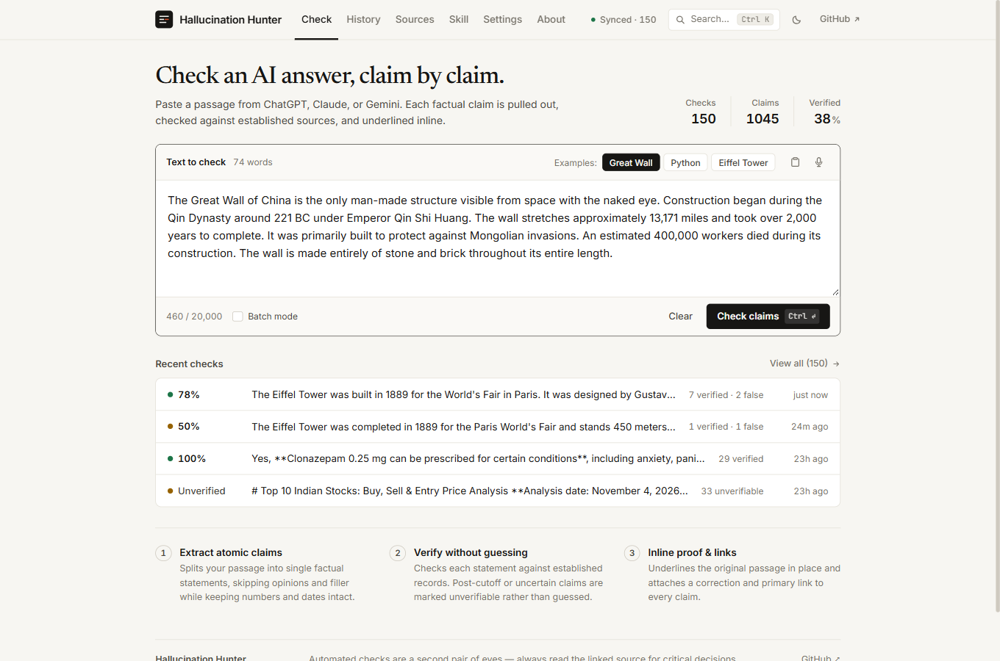
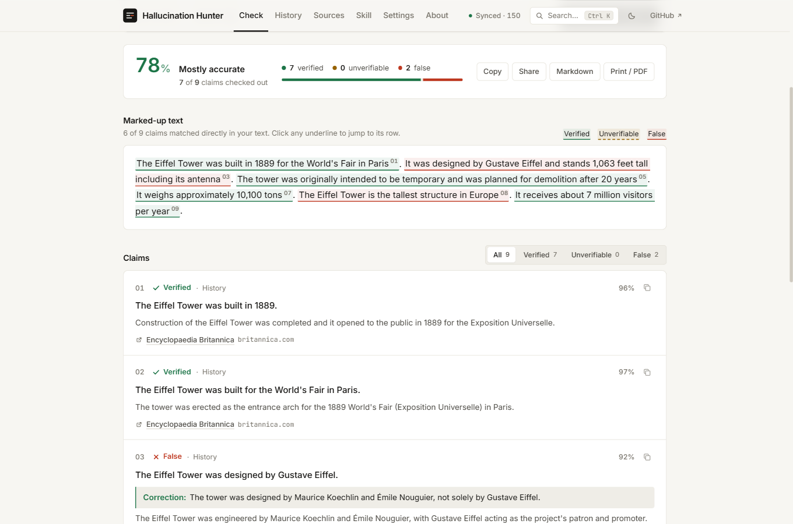
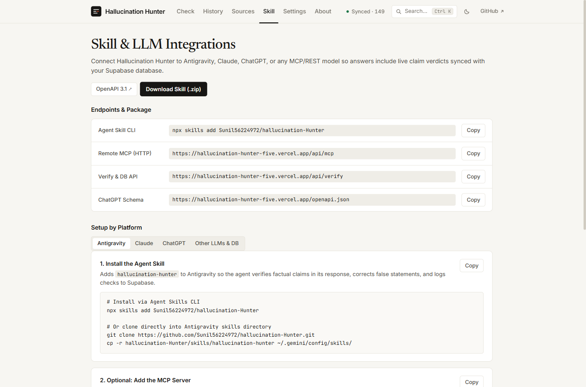
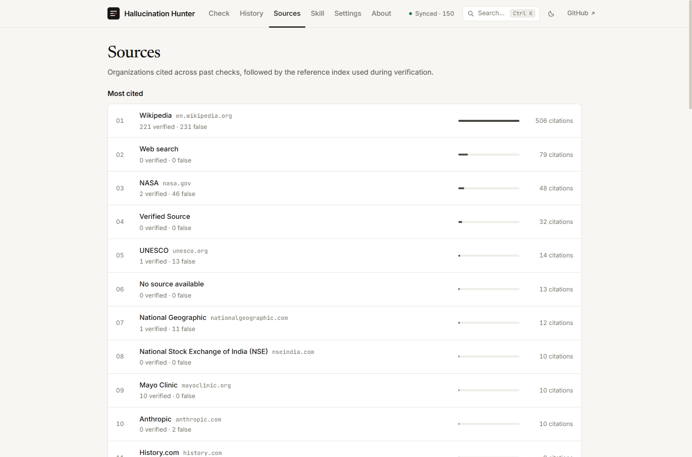
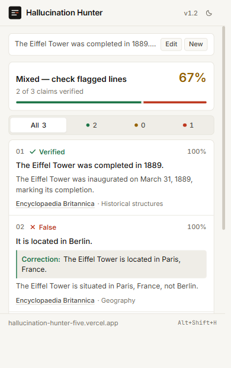

# Hallucination Hunter

Claim-by-claim fact-checker for AI-generated answers. Paste a passage from ChatGPT, Claude, Gemini, or any other model—or connect Hallucination Hunter directly inside your assistant—to split a reply into atomic factual statements, check each line against established sources and past records, and flag contradictions with a correction and source link.

Live app: **https://hallucination-hunter-five.vercel.app**  
Android APK: **[Download HallucinationHunter.apk (`apk-v1`)](https://github.com/Sunil56224972/hallucination-Hunter/releases/download/apk-v1/HallucinationHunter.apk)**

Built with plain HTML, CSS, and ES2022 JavaScript on Vercel serverless Node functions, backed by Groq (`openai/gpt-oss-120b`), DuckDuckGo source lookup, and Supabase Postgres (`ap-south-1`). There is no frontend framework or build step.

```
Browser / Extension / APK ──POST /api/groq, /api/search──┐
                                                         ▼
Claude / Antigravity / Cursor ──Skill CLI / /api/mcp──> ┌──────────────────────────┐
                                                        │   Hallucination Hunter   │
ChatGPT Custom GPT / REST ──────POST /api/verify──────> │  Extract · Check · Cite  │
                                                        └────────────┬─────────────┘
                                                                     │
                     ┌───────────────────────────────────────────────┼───────────────────────────────────────────┐
                     ▼                                               ▼                                           ▼
        ┌────────────────────────┐                      ┌────────────────────────┐                  ┌────────────────────────┐
        │ Groq Inference         │                      │ Live Source Lookup     │                  │ Supabase Postgres      │
        │ openai/gpt-oss-120b    │                      │ DuckDuckGo + Reference │                  │ analyses · claims ·    │
        │ Claim split & verdicts │                      │ domain matching        │                  │ settings (ap-south-1)  │
        └────────────────────────┘                      └────────────────────────┘                  └────────────────────────┘
```

---

## How a check runs

| Step | Stage | What happens |
| :--- | :--- | :--- |
| **01** | **Extract** | Strips opinions, hedging, and filler from the input text and breaks objective statements into standalone atomic claims (up to 40 per run) while preserving exact numbers, dates, versions, and substrings for inline underlining. |
| **02** | **Cross-check** | Queries prior verdicts in the Supabase `claims` ledger in parallel with model verification so recurring statements surface previous checks alongside fresh evaluation. |
| **03** | **Verify** | Evaluates each claim with strict uncertainty rules: post-cutoff events, unconfirmed version specs, or unverifiable attributions are marked `unverifiable` rather than guessed. Contradicted claims get a one-sentence correction, and claims are paired with live source URLs via DuckDuckGo. |
| **04** | **Record** | Computes the trust score across verifiable claims (`Unverified` when every claim is unverifiable), underlines claims inline in the passage, returns a Markdown co-pilot report for connected assistants, and writes the run to Supabase Postgres. |

---

## Connecting your assistant

Hallucination Hunter ships as a portable **Agent Skill**, a **Model Context Protocol (MCP) server** (remote HTTP and local stdio), and an **OpenAPI 3.1 Action** so assistants can check factual claims in their own draft before answering and sync every run to the shared Supabase ledger.

### 1. Agent Skill (Antigravity, Claude Code, Cursor, Windsurf, Codex CLI)

Install directly from GitHub with the Agent Skills CLI:

```bash
npx skills add Sunil56224972/hallucination-Hunter
```

Or copy `skills/hallucination-hunter` manually into your tool's skill directory (`~/.gemini/config/skills/` for Antigravity, `~/.claude/skills/` for Claude Code):

```bash
git clone https://github.com/Sunil56224972/hallucination-Hunter.git
cp -r hallucination-Hunter/skills/hallucination-hunter ~/.gemini/config/skills/
```

For **Claude.ai** on the web, download [`assets/hallucination-hunter-skill.zip`](https://hallucination-hunter-five.vercel.app/assets/hallucination-hunter-skill.zip) and upload it under **Settings -> Capabilities -> Skills**.

You can also run the zero-dependency skill CLI directly from Node 18+:

```bash
# Verify a draft and return a Markdown co-pilot block
node skills/hallucination-hunter/scripts/verify.mjs \
  --text "The Eiffel Tower opened in 1889 and stands in Berlin." \
  --client antigravity

# Search previously verified claims in Supabase
node skills/hallucination-hunter/scripts/verify.mjs --search "Eiffel Tower" --status false
```

### 2. MCP server (Claude Desktop, Antigravity, Cursor, Windsurf)

Point any Streamable HTTP MCP client at the hosted endpoint—no local install required:

```json
{
  "mcpServers": {
    "hallucination-hunter": {
      "url": "https://hallucination-hunter-five.vercel.app/api/mcp"
    }
  }
}
```

If your client only supports local `stdio` servers, run `mcp/server.mjs` with Node 18+:

```json
{
  "mcpServers": {
    "hallucination-hunter": {
      "command": "node",
      "args": ["/absolute/path/to/hallucination-Hunter/mcp/server.mjs"]
    }
  }
}
```

Exposed MCP tools:
- `verify_llm_response` — extracts atomic claims from an assistant draft or user passage, verifies each claim, writes the audit record to Supabase (`user_id: "skill:<client>"`), and returns structured verdicts plus `markdownReport`.
- `search_factcheck_database` — searches past claims and analyses in Supabase by keyword and verdict filter (`verified`, `false`, `unverifiable`).

### 3. ChatGPT Custom GPT Action (OpenAPI 3.1)

1. In the GPT editor, open **Configure -> Actions -> Create new action**.
2. Click **Import from URL** and paste:
   ```text
   https://hallucination-hunter-five.vercel.app/openapi.json
   ```
3. Set **Authentication** to **None** (or **API Key / Bearer** if passing your own `gsk_...` Groq key).
4. Add to your GPT instructions:
   > Before finalizing answers with factual claims, dates, statistics, citations, or version numbers, call `verifyClaims` (`client`: `"chatgpt"`), fix any claim marked `false` in your prose, and append the returned `markdownReport`.

### 4. REST API (`curl` / custom pipelines)

```bash
# Verify text and log to Supabase
curl -s https://hallucination-hunter-five.vercel.app/api/verify \
  -H "Content-Type: application/json" \
  -d '{
    "text": "Python was created by Guido van Rossum in 1991. Python 2 and Python 3 are fully backward compatible.",
    "client": "curl-demo",
    "saveToDatabase": true
  }'

# Query stored claims and analyses
curl -s "https://hallucination-hunter-five.vercel.app/api/verify?search=Python&limit=5"
```

Pass `"saveToDatabase": false` for ephemeral checks, or send `Authorization: Bearer gsk_...` to run verification against your own Groq API key.

---

## Screens

### Check console


### Inline markup and claim verdicts


### Skill, MCP, and OpenAPI setup (`#/skill`)


### Cited sources and reference directory (`#/sources`)


### Chrome extension (`v1.2`)


---

## Quick start (local development)

Requires Node 18 or newer.

```bash
git clone https://github.com/Sunil56224972/hallucination-Hunter.git
cd hallucination-Hunter

# Serve static files locally (no build step)
npx serve -l 3000
```

Open `http://localhost:3000`. When opened locally without keys, the web UI proxies checks through `https://hallucination-hunter-five.vercel.app`. To run the serverless API routes locally as well:

```bash
export GROQ_API_KEY="gsk_..."
npx vercel dev
```

---

## Chrome extension (`v1.2`)

Check text on any webpage without leaving the tab:

1. Open `chrome://extensions/` in Chrome, Edge, Brave, or Arc.
2. Turn on **Developer mode**.
3. Click **Load unpacked** and choose the `chrome-extension/` folder.
4. Highlight any passage on a webpage, right-click, and pick **Check with Hallucination Hunter** (or press `Alt+Shift+H`).

---

## Android app

Download the signed installable package directly from GitHub Releases:
- **[HallucinationHunter.apk (`apk-v1`)](https://github.com/Sunil56224972/hallucination-Hunter/releases/download/apk-v1/HallucinationHunter.apk)**

To rebuild the Capacitor Android project from source:

```bash
npx @capacitor/assets generate --android
npx cap sync android
cd android && ./gradlew assembleDebug
```

---

## Endpoints

| Method | Path | Purpose |
| :--- | :--- | :--- |
| `POST` | `/api/verify` | End-to-end claim extraction, verification, DuckDuckGo source lookup, Supabase sync, and Markdown report generation (12 req/min/IP; optional `Bearer gsk_...`). |
| `GET` | `/api/verify` | Search stored claims and recent analyses in Supabase (`?search=`, `?verdict=`, `?limit=`). |
| `POST`, `GET` | `/api/mcp` | Remote Model Context Protocol server over stateless Streamable HTTP (JSON-RPC `2025-03-26`). |
| `POST` | `/api/groq` | Rate-limited Groq proxy used by the web console and Chrome extension (10 req/min/IP). |
| `POST` | `/api/search` | Live DuckDuckGo source resolver for claim verification cards. |
| `GET` | `/openapi.json` | OpenAPI 3.1 specification for ChatGPT Actions and OpenAPI tool importers. |
| `GET` | `/llms.txt` | Plain-text integration summary for LLM crawlers and coding agents. |

---

## Database schema (Supabase Postgres)

Checks from the web console, Chrome extension, Android app, Agent Skill, MCP server, and ChatGPT Action share three tables in Supabase (`ap-south-1`):

```text
public
├── analyses   # id, input_text, trust_score, total_claims, verified_count, unverifiable_count, false_count, model_used, user_id, created_at
├── claims     # id, analysis_id, claim_text, status ('verified'|'unverifiable'|'false'), confidence, explanation, source_name, source_url, user_id, created_at
└── settings   # id, key, value, user_id, updated_at
```

Runs originating from connected assistants tag `user_id` as `skill:<client>` (for example `skill:antigravity`, `skill:claude`, or `skill:chatgpt`) and show an origin badge in the **History** view.

```sql
CREATE INDEX IF NOT EXISTS idx_claims_analysis_id ON claims(analysis_id);
CREATE INDEX IF NOT EXISTS idx_analyses_created_at_desc ON analyses(created_at DESC);
CREATE INDEX IF NOT EXISTS idx_settings_key_user ON settings(key, user_id);
```

---

## Project layout

```text
hallucination-Hunter/
├── index.html                           # Single-page web console (Check, History, Sources, Skill, Settings, About)
├── style.css                            # Light & dark editorial stylesheet
├── app.js                               # Client verification flow, inline underline matcher, SpeechRecognition & Supabase sync
├── sw.js                                # Offline shell service worker (hh-v16)
├── openapi.json                         # OpenAPI 3.1 schema for ChatGPT Custom GPT Actions
├── llms.txt                             # Machine-readable project & endpoint index
├── vercel.json                          # CORS, security, and cache headers
├── api/
│   ├── verify.js                        # Unified verify + Supabase search/sync API for LLMs, Skills & REST
│   ├── mcp.js                           # Serverless Streamable HTTP MCP endpoint
│   ├── groq.js                          # Browser/extension Groq proxy with per-IP rate limiting
│   └── search.js                        # Live DuckDuckGo source lookup
├── mcp/
│   └── server.mjs                       # Local stdio MCP server (zero npm dependencies)
├── skills/
│   └── hallucination-hunter/
│       ├── SKILL.md                     # Portable Agent Skill instructions
│       ├── scripts/verify.mjs           # Zero-dependency Node CLI for verification & DB search
│       └── references/platform-setup.md # Per-platform setup configs (Claude, Antigravity, ChatGPT, Cursor)
├── chrome-extension/                    # Chrome / Edge / Brave Manifest V3 extension (v1.2)
├── assets/                              # Favicons, PWA icons, brand media & hallucination-hunter-skill.zip
├── resources/                           # Capacitor Android icon and splash sources
└── screenshots/                         # Current UI screenshots used in this README
```

---

## License

MIT © [Sunil](https://github.com/Sunil56224972). See [LICENSE](LICENSE) for details.
